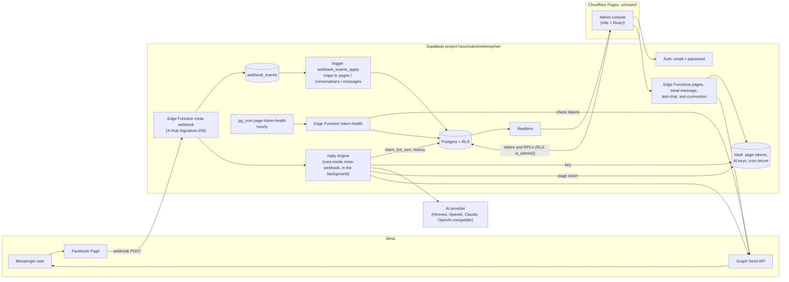

# UniMatch

UniMatch runs a Facebook Page chatbot that answers students' job questions on Messenger. It also has an admin console where staff read conversations, take over from the bot, set up the bot and its AI provider, and connect Pages.

- Board: https://github.com/users/hoangi19/projects/4 (issues in `hoangi19/unimatch` are written in Vietnamese)
- Console: https://unimatch-1va.pages.dev
- Static prototype and visual spec: `demo/index.html`. Design tokens and rules: `design-system/unimatch/MASTER.md`.

## Architecture



What happens when a customer writes to the Page:

1. Meta POSTs the event to `meta-webhook`. The function checks the HMAC signature against `META_APP_SECRET` and stores each event in `webhook_events`. Duplicates are skipped by `external_id`.
2. The `AFTER INSERT` trigger on `webhook_events` maps the event to `pages`, `conversations` and `messages` in the same transaction. It sets `webhook_events.status` to `processed`, `ignored`, `no_page` or `failed`. The raw event is never lost.
3. In the background, `meta-webhook` runs the reply engine (`supabase/functions/_shared/bot/`). It waits for a short debounce, then takes a per-conversation lease (`claim_bot_turn`). It checks handoff keywords, `bot_enabled`, the conversation status, the Page's reply hours and the hourly rate limit. Then it calls the active AI provider with the key from Vault and sends the reply through the Send API. The reply is stored with `record_outbound_message`. A failed send hands the conversation to a person.
4. The console gets the new rows through Realtime.

The admin console is a static site. It signs in with Supabase Auth and reads tables directly under RLS (`public.is_admin()`). It calls admin RPCs (`set_provider_key`, `set_conversation_mode`, `inbox_stats`, …) and the admin Edge Functions: `pages` to connect Pages, `send-message` to reply as an admin, and `test-chat` and `test-connection` for the Chatbot tab. Page tokens and AI keys live only in Vault, and only service-role code decrypts them. Every hour, pg_cron calls `token-health`, which marks Pages whose token Meta rejects so the console shows "Reconnect".

More detail: `docs/supabase.md` (data, access rules, Edge Functions), `docs/security.md` (security checks), `docs/runbook.md` (operations).

## Repo layout

| Path | What |
|------|------|
| `web/` | Admin console: Vite + React + TypeScript + Tailwind. `src/inbox`, `src/pages`, `src/chatbot` are the tabs; `src/ui` the shared components; `src/lib/database.types.ts` is generated. |
| `supabase/migrations/` | SQL migrations, one per PR, created with `supabase migration new <name>`. |
| `supabase/functions/` | Edge Functions (Deno). `_shared/` holds the AI providers, the bot engine, the Messenger sender, CORS and Graph helpers. |
| `supabase/tests/` | SQL tests, run against hosted with `scripts/sql-test.sh`. |
| `supabase/config.toml` | Per-function `verify_jwt` settings. The local-stack sections are CLI defaults and are not used. |
| `scripts/` | Local checks, seed, deploys and secret scan (see below). |
| `docs/` | Supabase workflow, security checklist, runbook. |
| `demo/`, `design-system/` | Static prototype and design system. |

## Environment variables and credentials

Names and locations only. Never commit or print a value.

| Name | Where it lives | Used by |
|------|----------------|---------|
| `SUPABASE_PROJECT_REF`, `SUPABASE_URL` | repo `.env` | scripts |
| `SUPABASE_PUBLISHABLE_KEY` | repo `.env` | web build (as `VITE_SUPABASE_PUBLISHABLE_KEY`). Safe for the browser. |
| `SUPABASE_SECRET_KEY` | repo `.env` | `scripts/seed.ts`. Bypasses RLS; never in the browser. |
| `SUPABASE_DB_PASSWORD` | repo `.env` | `scripts/supabase-deploy.sh` (`supabase db push`) |
| `META_APP_ID`, `META_LOGIN_CONFIG_ID`, `META_PAGE_ID` | repo `.env` | web build (`VITE_META_*`), live tests |
| `META_VERIFY_TOKEN` | repo `.env` and Edge Function secret | `meta-webhook` GET handshake |
| `CLOUDFLARE_ACCOUNT_ID`, `CLOUDFLARE_PAGES_PROJECT` | repo `.env` | `scripts/deploy-web.sh` |
| `VITE_SUPABASE_URL`, `VITE_SUPABASE_PUBLISHABLE_KEY`, `VITE_META_APP_ID`, `VITE_META_LOGIN_CONFIG_ID` | `web/.env.local` (copy of `web/.env.example`) | `npm run dev`. The deploy script fills them from `.env`. |
| `META_APP_SECRET` | Edge Function secret only | `meta-webhook` signature check |
| `SUPABASE_URL`, `SUPABASE_SERVICE_ROLE_KEY` | Edge Function env, set by the platform | all functions |
| Supabase access token | `~/.supabase-token` | CLI and Management API in scripts |
| Cloudflare API token | `~/.cloudflare-token` | `scripts/deploy-web.sh` |
| Page access tokens | Vault, one secret per Page | Send API, `token-health` |
| AI provider keys | Vault, `ai_provider_key:<kind>` | reply engine, `test-chat`, `test-connection` |
| `token_health_cron_secret` | Vault, generated in the database | pg_cron → `token-health` |
| Test admin password | macOS Keychain, service `unimatch-test-login` | signing in to the console |

The repo `.env` and `web/.env.local` are git-ignored. The GitHub Environment `production` keeps copies for reuse only; nothing runs there.

## Getting started

There is **no local Supabase stack**, by decision, and no separate dev project. "Local" means the `web/` dev server and the check scripts on your machine, against the hosted project. Clean up any hosted data your tests create.

### 1. Tools

- Node 24 or later, npm
- Deno 2
- Supabase CLI
- `jq`, `gitleaks`, `gh`
- macOS for the Keychain lookup below (or get the test admin password another way)

### 2. Credentials

Ask the maintainer for the repo `.env` and put it at the repo root. To run deploy or SQL test scripts you also need `~/.supabase-token` (and `~/.cloudflare-token` for web deploys). Keep these files at mode 600.

### 3. Run the console

```sh
cd web
cp .env.example .env.local   # then fill VITE_SUPABASE_PUBLISHABLE_KEY from SUPABASE_PUBLISHABLE_KEY in ../.env
npm ci
npm run dev                  # http://localhost:5173
```

Sign in as `admin@unimatch.test`. Copy the password with `security find-generic-password -s unimatch-test-login -w | pbcopy` (it stays off the screen) and paste it into the login form. The admin Edge Functions accept `http://localhost` on any port (CORS), so the whole console works from the dev server.

### 4. Demo data

```sh
deno run --env-file=.env -A scripts/seed.ts           # insert seed rows (re-running is safe)
deno run --env-file=.env -A scripts/seed.ts --clean   # delete only seed rows
```

The seed adds a Page `seed-demo` ("seed: Demo page") with no token. It has two conversations: one with the bot and one handed off by keyword, with a handoff event. It also adds three raw `webhook_events` that stay `no_page`, which is how events look before their Page is connected. Every row is pinned by a `seed-demo` / `seed:` filter, and `--clean` deletes only those rows. Do not replay the `seed-demo` events: the conversations they would create do not use the `seed:` prefix, so `--clean` would not remove them. The seed rows are defined in `scripts/seed_registry.ts`; see `docs/supabase.md` to add a table.

### 5. Add an admin user

Sign-up is off and only `app_metadata.role = 'admin'` passes `is_admin()`. `user_metadata` does not count. To add an admin:

1. Supabase dashboard → Authentication → Users → **Add user** → **Create new user**, with email and password, and tick auto-confirm. Or use the Auth admin API with the secret key: `POST /auth/v1/admin/users` with `{"email": …, "password": …, "email_confirm": true}`.
2. Set the role. In the SQL editor:
   ```sql
   update auth.users
   set raw_app_meta_data = raw_app_meta_data || '{"role": "admin"}'
   where email = 'new.admin@example.com';
   ```
   Or call `PUT /auth/v1/admin/users/<id>` with `{"app_metadata": {"role": "admin"}}`.
3. The user signs out and in again, so the new JWT carries the role.

To remove admin rights, remove the `role` key the same way, or delete the user.

## Checks

There is no CI. Run these yourself before pushing:

| Command | What |
|---------|------|
| `cd web && npm run check` | oxlint, `tsc -b`, vitest, production build |
| `scripts/supabase-check.sh` | `deno lint`, `deno check` on every function and the seed, Deno unit tests. Needs no network. |
| `scripts/sql-test.sh <new-migration.sql> supabase/tests/<name>_test.sql` | Runs SQL tests on hosted in one transaction that always rolls back |
| `zsh scripts/scan-secrets.sh` | gitleaks plus the project's key prefixes. Must print "no secrets found" before every push. `--all` scans the full history. |

## Deploy

The maintainer (PM) deploys from this machine after merging. Do not deploy from a feature branch, except for a web preview.

| Command | What |
|---------|------|
| `scripts/supabase-deploy.sh` | From a clean `main` at `origin/main`: links the project, runs `supabase db push`, deploys all Edge Functions, regenerates `web/src/lib/database.types.ts`. Commit the types file if it changed. |
| `scripts/deploy-web.sh` | Runs `npm ci` and `npm run check`, then `wrangler pages deploy`. From `main` it deploys production; from any other branch it deploys a preview at `<branch>.unimatch-1va.pages.dev`. |
| `scripts/set-meta-app-secret.sh` | Hidden prompt; sets `META_APP_SECRET` in Supabase and in the GitHub `production` environment. |

## Conventions

- English for code, comments, commits, PRs and docs. Commits have no ticket IDs. PR title: `[#<issue>] <type>: <summary>`, body links `Closes #<issue>`.
- Branch `feat/issue-<n>-<slug>` from `origin/main`, in worktree `.worktrees/issue-<n>`.
- One migration per PR.
- Live tests use the Meta app `uniagent` and the UniMatch Page. See `CLAUDE.md`.
